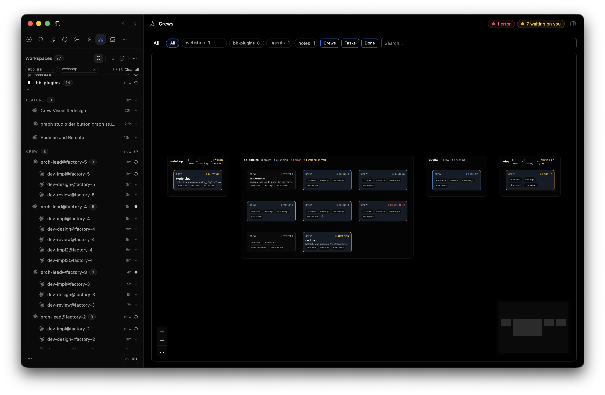
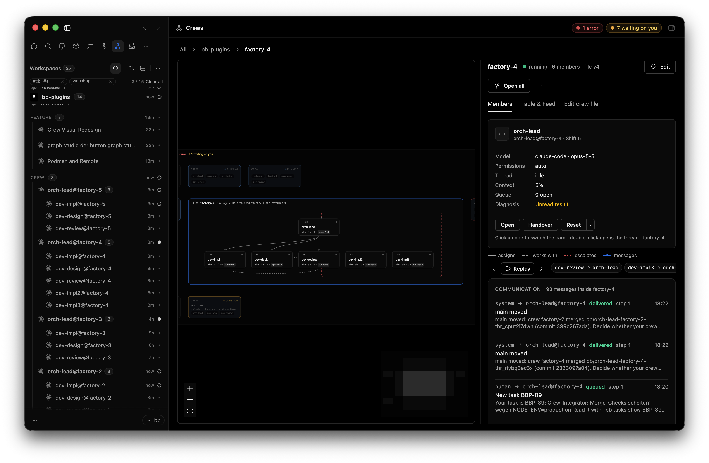

# Crew

A declarative runtime for agent workflows, from isolated pipelines to
communicating multi-agent teams. A harness wraps a model; a crew wraps
harnesses.

A crew is described in a `crew.yaml`: groups of members, each with a fixed
address (`dev-owner@my-crew`), its own provider and model, a role and
permissions. `bb crew apply` reconciles the file against BB threads — the
lead's thread is the parent, every member is a child thread — and keeps doing
so as the file changes. The lead orchestrates rather than doing the work
itself: it assigns, waits, collects and hands artifacts on. Whether members
also message each other, share a channel and a work queue is a choice in the
file, not the default — see [Topologies](#topologies) below. Several crews in
one project can coordinate through their leads, BB Tasks and `main`. You see
who works, who waits and who needs you.

[Graph Studio](../bb-plugin-graph-studio) describes a flow that ends; a crew is a team that stays. Both
combine: a Graph Studio `member` node runs a step on a crew member instead of
a fresh thread.





Inspired by [OpenRig](https://github.com/mvschwarz/openrig) for
[herdr](https://github.com/herdrdev/herdr).

## Install

```sh
bb plugin install git:https://github.com/sajov/bb-plugins.git \
  --subdirectory bb-plugin-crew
```

Requires BB with plugin SDK 0.6.15 or newer.

## A crew file

```yaml
version: "1"
name: pair
summary: Owner builds, checker verifies the exact candidate.
instructions: Every handoff names the exact commit or file set.
baseBranch: main
groups:
  - id: dev
    members:
      - id: owner
        lead: true
        provider: claude-code
        model: claude-sonnet-5
        role: Implements exactly one bounded change at a time.
      - id: check
        provider: claude-code
        model: claude-sonnet-5
        permissions: ask
        context: per-item # default: persistent
        role: Checks only the commit, acceptance criteria and gate result from the work item.
links:
  - { from: dev-owner, to: dev-check, kind: assigns_to }
```

Provider and model always sit on the member itself. Writing members get their
own worktree; readers share the crew's.

A member's key is `<group>-<member>` (`dev-owner`, address
`dev-owner@pair`). With `memberKeys: short` at crew level the key is the
member id alone, so links and messages name `owner` and the address is
`owner@pair`; member ids must then be unique across all groups:

```yaml
version: "1"
name: pair
memberKeys: short # default: grouped
groups:
  - id: dev
    members:
      - { id: owner, lead: true, provider: claude-code, model: claude-sonnet-5 }
      - { id: check, provider: claude-code, model: claude-sonnet-5 }
links:
  - { from: owner, to: check, kind: works_with }
```

`context:` on a member is `persistent` (default) or `per-item`. A per-item
member starts a new shift for every work item assigned to it (`crew_work_create`
with an owner, `crew_work_handoff`): the old thread ends, the new one starts
with the kickoff brief and the work item, nothing else. While it still has a
claimed, unfinished item, a new assignment waits as a normal message instead.
Use it for reviewers, so every review starts without the previous candidate.
The plan warns with `review-reads-author` when a member whose role mentions
review or check has `can_read` or `works_with` on a member that assigns it
work; it is only a warning, apply still runs.

`skills:` and `graphs:` are optional on crew, group and member, and inherit
the same way `instructions` does (crew → group → member, each name kept
once). `skills:` names skills to prefer, resolved against `~/.bb/skills`,
`~/.bb/skills-generated`, `~/.claude/skills` and the project's own
`.bb/skills` and `.claude/skills`; an unknown name
only warns. `graphs:` names Graph Studio graphs the member may run with
`crew_graph_run`; an unknown graph id only warns too — nothing is installed
or validated beyond the name.

## Topologies

The same file format carries several shapes, chosen by the links and
`messaging` setting, not by a separate mode:

- **Isolated pipeline** — the lead assigns one artifact per step and collects
  the result; steps never message each other (`messaging: links`, only
  `assigns_to`/`escalates_to` links, no `works_with` between workers). Each
  member works in a fresh, private context. This is the shape to reach for in
  agentic coding: a reviewer that only sees the named commit, never the
  implementer's reasoning, catches more than one that shares memory with it.
  See `examples/pipeline.yaml`.
- **Communicating team** — members also message each other directly
  (`works_with` links, `messaging: open`), useful when two roles genuinely
  need a shared back-and-forth. See `examples/team.yaml`.
- **Hierarchical** — a lead delegates to members who never talk sideways,
  only up and down (the `trio` template).
- **Hybrid** — any mix: some members isolated, others sharing a channel,
  several groups under one lead.

The templates `pair` and `trio` give their reviewer an independent context:

- `pair`: `dev-check` has `context: per-item`; the `works_with` between
  `dev-owner` and `dev-check` and the escalation from `dev-check` back to
  `dev-owner` are replaced by `assigns_to` `dev-owner` → `dev-check`. The
  checker escalates to the human, as every member can.
- `trio`: `dev-review` has `context: per-item`; the `works_with` between
  `dev-impl` and `dev-review` is gone.
- Both reviewers' roles: check only the commit, acceptance criteria and gate
  result from the work item.

Isolation is a design choice the format makes explicit, not an afterthought:
a member only ever sees what the lead or its declared links hand it. Nothing
here is specific to coding — the same topology choice applies to support
chats, research fan-out, or any multi-step agent workflow.

### The Pocock process as a crew

Matt Pocock's loop — grill → spec → tickets → implement → review → retro —
maps onto crew as an isolated pipeline: the skills (`grilling`, `to-spec`,
`tdd`, `code-review`, …) stay the actual capabilities, crew only decides which
member runs which skill, when, with which artifact. The lead orchestrates the
whole process, not just the implement step; it starts a step, waits for its
artifact, and hands exactly that artifact to the next one. `examples/pipeline.yaml`
is this pipeline with grill, spec, tickets, implement and review as separate,
non-communicating members.

## Running a Graph Studio graph from a member

A member whose `graphs:` list is non-empty gets `crew_graph_run(graph, input)`:
it starts the named graph on Graph Studio, blocks until the run is done,
failed, stopped, or times out, and returns the result with the run id. The
member's address, key and role go into the run's input explicitly; the graph
never sees the member's thread.

Every run is linked back to the member and crew that started it (durably, so
it survives a restart): the member card lists it with its live status, and **Needs you** gets an entry with reason
`graph-approval` and the waiting human node's question while a run sits on one
— gone again once the run continues or ends. `bb crew stop` cancels a crew's
open runs; `bb crew delete --threads delete` also deletes their worker
threads, since Graph Studio's own threads are not BB children of the
member's thread.

## Usage

```sh
bb crew templates                              # pair, trio, research
bb crew plan trio                              # read-only: one action per member
bb crew apply crew.yaml [--fresh <member>…] [--confirm-full]
bb crew ps                                     # members, thread state, shift, provider/model
bb crew needs                                  # who waits for you, with the question
bb crew send dev-impl@trio "Start with step 1" --subject TASK-1
bb crew log --crew trio [--chain <id>] [--cross-crew]
bb crew merges | approve <mr> | reject <mr> "reason"
bb crew snapshot trio && bb crew restore <snapshot>
bb crew handover dev-impl@trio
bb crew stop trio [--archive]
bb crew delete trio [--threads archive|delete|keep]
```

In the app, **Crews** in the sidebar opens one zoomable canvas with four
levels: all projects → one project → one crew → one member. A breadcrumb shows
where you are, Esc goes up one level. The project filters and the **Crews**,
**Tasks** and **Done** toggles sit on the top level; BB Tasks labelled
`crew-<crew>` are drawn as edges to the crew working on them. Every card shows
the crew's state (running, stopped, waits on you), and the header counts
**Needs you** across all projects.

Selecting a crew opens its side panel with the tabs Members, Table & Feed and
Edit crew file (YAML and form, BB's provider/model picker, a preview identical
to `bb crew plan`, one Apply button); **Edit** opens the same editor full
screen. The member card has Open, Handover and Reset; Replay steps through the
crew's messages. Member threads carry a header badge, and `::crew{crew="…"}`
renders a live card in chat that opens the crew in the thread sidebar.

**Needs you** only lists what needs a decision: an open question or approval,
a merge request, a merge conflict, a stopped loop with its reason, or a graph
run waiting on a human node. Merge requests whose branch is already in the
base branch, questions about a task that is done, and loops without a reason
drop out on their own.

The full command and agent-tool reference is the skill:
[skills/crew/SKILL.md](skills/crew/SKILL.md).

## Crews talking to each other

Several crews in one project — say `api` and `web`, each on its own feature —
can talk across their boundary.

- **Who may talk:** `crossCrew: leads` (default) lets only the leads message
  another crew; other members go through their lead. `open` allows everyone,
  `none` isolates the crew. Between two crews the stricter setting wins. The
  human is reachable from every crew as `human`: `kind: "info"` for status
  reports (no Needs you, nobody waits), `kind: "question"` (default) when an
  answer is needed.
- **How:** a lead calls `crew_send(to: "web-lead@web", …)`; `crew_directory`
  lists all crews of the project with task, status, branch and lead.
- **Waiting on another crew:** `waitsFor: [{ task: TASK-1, until: merged }]` in
  the crew file. Several entries are an AND: the waiting lead gets one notice
  only after every declared condition holds (for `merged`: the other crew's work
  is in `baseBranch`), never because one of them does. The notice is a durable
  obligation in the plugin's messages queue, written together with the state
  that completes the set. It asks the lead to re-read the sources and re-check
  its own guards; it is not an acceptance, review, rebase or publication, starts
  nothing by itself, and whether and when to rebase stays the lead's decision.
  The conditions mean only what they say (`merged`, `done`, `work-done`,
  `comment:<kw>`), not reviewed, served or accepted. Delivery to the thread is
  attempted while a destination is reachable; a terminal failure is recorded as
  `failed`, so delivery is not guaranteed and never exactly-once. A changed
  crew file is a new declaration.
- **Waiting on a work item:** `waitsFor: [{ task: wi_1a2b3c4d, until: work-done }]`
  reads the plugin's own work queue instead of BB Tasks. `task` is the **exact
  id** of a native work item (as `bb crew work` lists it) that must be `done`,
  in a crew of the same project (another crew of the project is fine). It is
  never resolved by title, task key or alias, and a missing id, an item of
  another project, or an item that is open, claimed or `failed` never satisfies
  it. It needs no BB Tasks, never calls it even when it is connected, and sets
  no `wartet-auf` label; `done`, `merged` and `comment:` keep their sources and
  meaning (`done` on a work item id is still a BB Tasks lookup). It joins the
  same AND and the same durable notice; the notice names the id, the crew and
  the milestone, not the item's text. `done` on a work item is a milestone of
  the queue, nothing more: the lead still re-reads the sources and its own
  guards.
- **Safety:** a reply chain keeps counting steps across crews and stops at
  `maxSteps` (default 6), so two crews cannot ping-pong forever.

Where you see it:

- **Project overview → Project feed** with "cross-crew only": every message
  between crews, including rejected and held ones. Lines between the crew
  cards show lead-to-lead traffic and `waitsFor`.
- **A crew's Table & Feed tab:** messages to and from other crews are marked;
  clicking one shows the whole chain.
- **CLI:** `bb crew log --cross-crew`, `bb crew directory`, `bb crew deps`.

```sh
bb crew send api-lead@api "Is the header schema stable?" --subject TASK-1
bb crew log --cross-crew
bb crew directory
bb crew deps --crew web
```

## Limits

- BB has no read-only permission mode, so `permissions: ask` runs as
  `accept-edits`; a checker stays read-only by its role.
- BB names worktree branches itself (`bb/<title>-<thread>`).
- Merge, rebase and checks run git in the BB server process: the repository
  must be on the machine BB runs on. Worktrees on other hosts are refused with
  a clear reason.
- A member session started before a plugin reload keeps its old tool set until
  it restarts (`bb crew apply --fresh <member>`).
- Sidebar row icons use an experimental SDK API.

## Development

```sh
npm install --include=dev --cache "$TMPDIR/npm-cache"
npx tsc --noEmit
npx vitest run
bb plugin build && bb plugin reload crew
```
